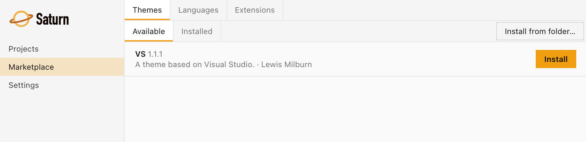

# Marketplace

The Saturn Marketplace allows you to install Languages, Extensions, and Themes (collectively called "Modules") to extend your Saturn editor.

## Installing modules

Open Saturn and click "Marketplace" from the main menu. If you already have a project open, click the settings icon in the top right, then click "Marketplace" -> "Open Marketplace"

<figure><figcaption></figcaption></figure>

The marketplace has a section each for Languages, Extensions and Themes. In each section, the **Available** tab lists modules you can install and the **Installed** tab lists the ones you have. To install a module, simply click "Install". Saturn will automatically check if the module is compatable with your Saturn version and prompt you to upgrade if needed.

<figure><figcaption></figcaption></figure>

To update your Saturn modules, simply click the "Update to X.X.X" button to the right of the module list.

<figure><figcaption></figcaption></figure>

## Installing from a file

To install a module that isn't in the marketplace, open the **Upload** menu and choose **Zip file…** or **Folder…**. In a zip, the manifest can be at the root or inside a single top-level folder.

Only install modules from people you trust.

## Languages

By default, Saturn only supports text files, but you can install new languages to gain a richer experience programming these.

These language modules add code completion, error detection, and run scripts to your editor.

Language modules only affect files that they support, for example the C# .NET module will not work on .js files.

## Extensions

Extensions provide additional functionality to the Saturn editor via actions. For example, the Claude Code extension adds buttons and actions to quickly launch and manage your Claude Code session.

## Themes

Themes change how Saturn looks. If you're coming from an IDE that uses a specific code colour palette, you may prefer to use one of these. Saturn also includes High Contrast and Dyslexia Friendly themes; see [Settings](settings.md#appearance).

If a theme is missing some items, Saturn still loads it and uses its own defaults for the missing items. At startup, it tells you which items are missing so you can report it to the theme's developer.

